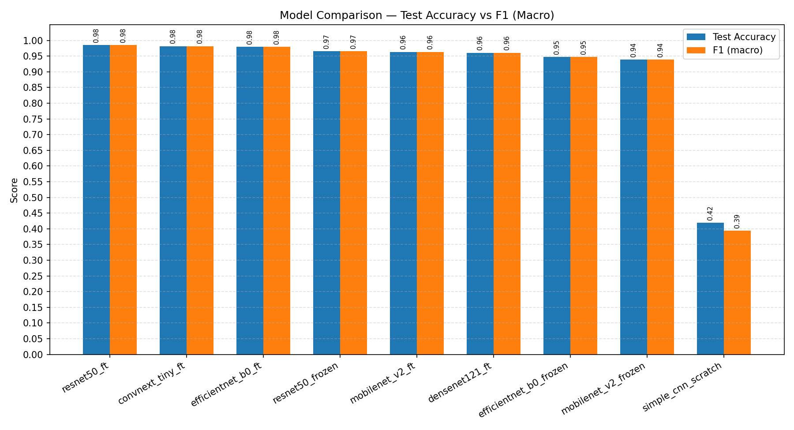
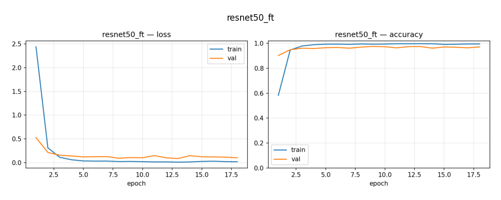
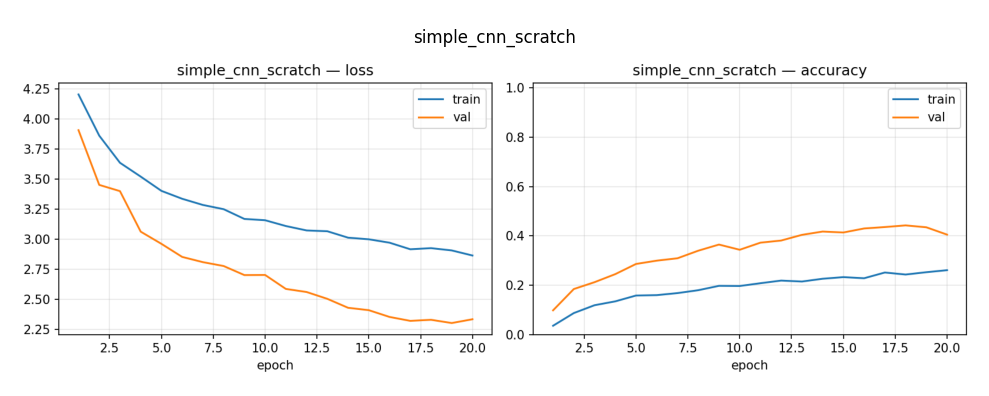
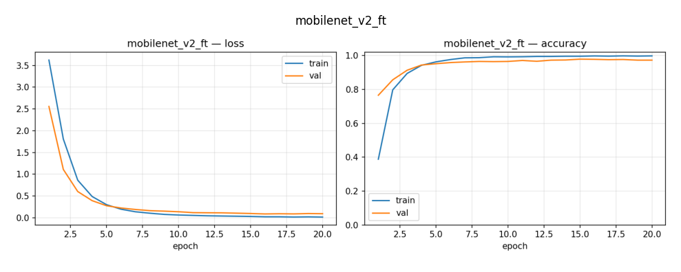
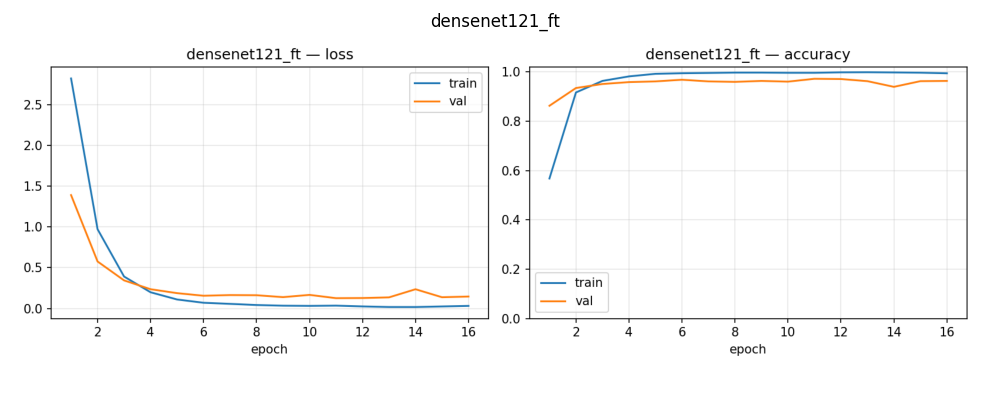

# Identifying 73 Everyday Objects with CNNs

**IE 7615 Deep Learning for AI · Discriminative Project (Milestones 1 and 2)**<br>
Study Group 6: Sankalp Hegde · Reshma Jose · Jairaghavendra Sridhar

We compare a convolutional network trained from scratch against five ImageNet-pretrained CNNs (transfer learning) on a
73-class single-object identification task built from photos taken by the whole class. Nine configurations were trained
and evaluated on one shared, stratified train/validation/test split.

| Milestone | Task | Best model | Result |
|---|---|---|---|
| **1** | Single-object identification (73 classes) | ResNet50 (fine-tuned) | 98.47% test accuracy, 0.9850 macro F1 |
| **2** · [`milestone2/`](milestone2/) | Multi-object detection on 2×2 to 5×5 grids (72 IDs): ID + location of every object | YOLOv8s | 0.893 mAP@0.5, precision 0.890, recall 0.856 |

**Milestone 1** is documented below. **Milestone 2** has its own README: [`milestone2/README.md`](milestone2/README.md).

---

# Milestone 1: Single-Object Identification

**Best model: ResNet50 (fine-tuned), 98.47% test accuracy, 0.9850 macro F1.**

📄 Full write-up: [`report/Milestone1_Report.pdf`](report/Milestone1_Report.pdf)<br>
💻 All code: [`notebooks/Group6_Milestone1.ipynb`](notebooks/Group6_Milestone1.ipynb)

---

## Results

All nine runs on the same held-out test set (1,043 images), sorted by test accuracy:

| Model | Mode | Accuracy | Precision | Recall | Macro F1 | Params | Train (s) | Inference (ms/img) |
|---|---|---:|---:|---:|---:|---:|---:|---:|
| **ResNet50** | fine-tuned | **0.9847** | **0.9862** | **0.9846** | **0.9850** | 23.66M | 1169.2 | 9.41 |
| ConvNeXt-Tiny | fine-tuned | 0.9818 | 0.9825 | 0.9816 | 0.9816 | 27.88M | 1931.2 | 5.90 |
| EfficientNet-B0 | fine-tuned | 0.9799 | 0.9813 | 0.9799 | 0.9799 | 4.10M | 1053.0 | 12.52 |
| ResNet50 | frozen | 0.9655 | 0.9687 | 0.9657 | 0.9654 | 23.66M | 1033.7 | 6.32 |
| MobileNetV2 | fine-tuned | 0.9636 | 0.9673 | 0.9639 | 0.9633 | 2.32M | 1010.5 | 6.10 |
| DenseNet121 | fine-tuned | 0.9607 | 0.9645 | 0.9609 | 0.9607 | 7.03M | 1045.9 | 16.32 |
| EfficientNet-B0 | frozen | 0.9473 | 0.9493 | 0.9478 | 0.9470 | 4.10M | 971.7 | 8.30 |
| MobileNetV2 | frozen | 0.9386 | 0.9417 | 0.9392 | 0.9384 | 2.32M | 955.6 | 5.61 |
| Simple CNN | from scratch | 0.4190 | 0.4273 | 0.4196 | 0.3936 | 0.64M | 962.0 | 1.23 |

<p align="center"></p>

### Key findings

- **Transfer learning is essential at this data size.** With roughly 65–70 training images per class, the from-scratch
  CNN reaches 41.9% accuracy (chance is 1.4%), while every pretrained model exceeds 93%.
- **Fine-tuning beats a frozen backbone for every architecture:** ResNet50 +1.92 pts, EfficientNet-B0 +3.26 pts,
  MobileNetV2 +2.50 pts.
- **Accuracy vs. size:** EfficientNet-B0 (fine-tuned) is within 0.5 points of ResNet50 with about one-sixth of the
  parameters, the recommended choice where model size or latency matters.
- **Errors are sparse.** The clearest repeated confusions are a power bank (OBJ057) vs. a notebook (OBJ003) and a
  Marshall speaker (OBJ009), and a sloth plushie (OBJ071) vs. a sleep mask (OBJ060).

### Training curves

| ResNet50 (fine-tuned): best model | Simple CNN (from scratch): baseline |
|---|---|
|  |  |
| **MobileNetV2 (fine-tuned)** | **DenseNet121 (fine-tuned)** |
|  |  |

---

## Dataset

Every student photographed one unique object about 100 times under varied lighting, angles, distances and backgrounds;
the course staff merged the submissions into one dataset with one folder per Object ID (`images_OBJ001` … `images_OBJ073`,
224×224 JPEG). The object names for each ID are in [`data/object_ids.csv`](data/object_ids.csv).

The images are **not included in this repository** (they belong to the course; access them through the course's shared
Google Drive folder). Cleaning rules applied by the notebook:

| Rule | Files |
|---|---:|
| Exclude background-only photos (`*_bg_*`, scenes with no object; reserved for Milestone 2) | 379 |
| Ignore anything nested inside an object folder (a stray copy of OBJ069 sits inside `images_OBJ018`) | — |
| Keep byte-identical duplicates within a class only once | 16 |
| **Images used** | **6,948** |

Split: stratified 70 / 15 / 15 with seed 42 → **4,863 train · 1,042 validation · 1,043 test**, shared by every run.

## Models and training setup

| Model | Pretrained | Modes tested |
|---|---|---|
| Simple CNN: 3 conv blocks (32/64/128) + BatchNorm + dense head with dropout | no | from scratch |
| ResNet50 | ImageNet | frozen, fine-tuned |
| EfficientNet-B0 | ImageNet | frozen, fine-tuned |
| MobileNetV2 | ImageNet | frozen, fine-tuned |
| DenseNet121 | ImageNet | fine-tuned |
| ConvNeXt-Tiny | ImageNet | fine-tuned |

*Frozen:* only the new 73-way classifier is trained. *Fine-tuned:* every layer is updated.

Identical for every run: 224×224 RGB input with ImageNet normalisation · batch size 32 · Adam (lr 1e-3 for scratch and
frozen, 1e-4 for fine-tuning) · up to 20 epochs with early stopping (patience 5 on validation loss) · best-validation
weights restored before testing · augmentation: random resized crop, horizontal flip, ±15° rotation, colour jitter.

## How to run

1. Open [`notebooks/Group6_Milestone1.ipynb`](notebooks/Group6_Milestone1.ipynb) in **Google Colab** and select a
   **T4 GPU** (Runtime → Change runtime type).
2. Add the course dataset folder to your Google Drive and set `DRIVE_DATA_DIR` in the configuration cell to the folder
   containing `images_OBJ001 … images_OBJ073`. Set `DRIVE_OUT_DIR` to where outputs should go.
3. Run all cells. The first run creates `split.csv`; later runs reuse it so every model sees the same images.

Each run saves to `DRIVE_OUT_DIR/results/`: `results_<tag>.json` (all metrics, training history, per-class report,
confusion matrix), `curves_<tag>.png`, `confusion_<tag>.png`, `predictions_<tag>.csv` and the best weights `<tag>.pt`.
The final cells collect every `results_*.json` into the comparison table and chart.

To run locally instead of Colab: `pip install -r requirements.txt`, skip the Drive-mount cell, and point the data/output
paths at local folders.

## Repository structure

```
├── notebooks/
│   └── Group6_Milestone1.ipynb   # complete pipeline: cleaning, split, 6 architectures, 9 runs, comparison
├── report/
│   └── Milestone1_Report.pdf     # Milestone 1 report
├── assets/                       # figures used in this README (from the report)
├── data/
│   └── object_ids.csv            # Object ID → object name (final class sheet)
├── milestone2/                   # YOLOv8 detection: labelling, grids, training, weights, results, report
├── requirements.txt
└── README.md
```

## Limitations and next steps

- Small per-class sample size (about 65–70 training images per class) limits how far generalisation can be assessed.
- Photos were taken independently with different phones, lighting and backgrounds.
- A few look-alike object pairs still cause occasional errors in the best models.
- **Milestone 2** (done, see [`milestone2/`](milestone2/)): multi-object grid images built from these single-object photos and
  a fine-tuned **YOLOv8** that detects, identifies and locates every object.
