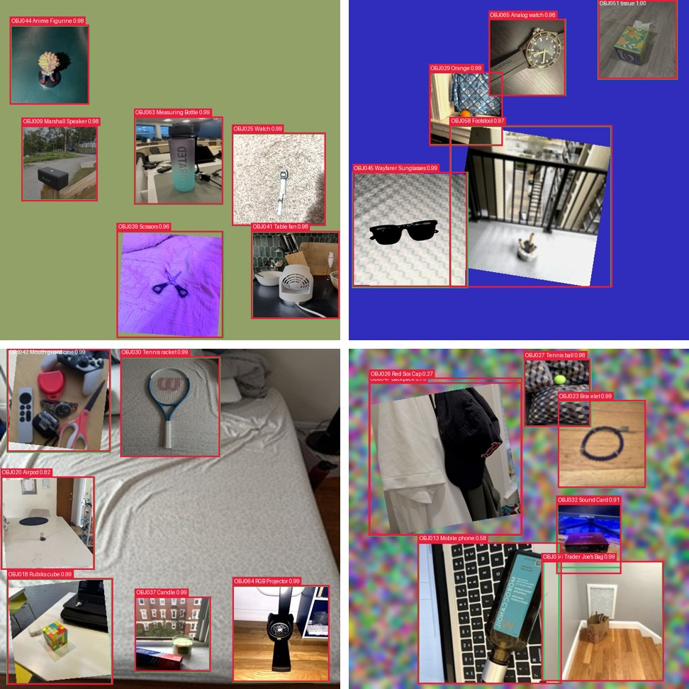
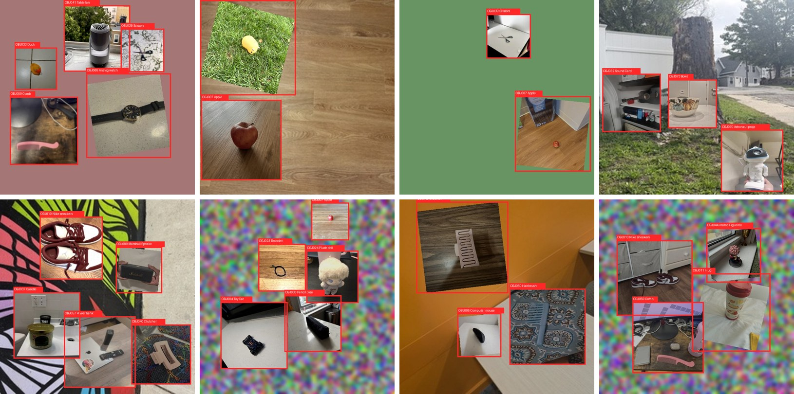

# Milestone 2: Multi-Object Detection with YOLOv8

Given an image containing several of the class's 73 objects, the model reports the **Object ID and location (bounding
box) of every object**. We generated a multi-object dataset by compositing randomly selected single-object images from
the final merged class dataset, then fine-tuned COCO-pretrained YOLOv8 detectors on it (transfer learning).

**Selected model: YOLOv8s, test mAP@0.5 = 0.971, mAP@0.5:0.95 = 0.963, precision 0.964, recall 0.941.**

📄 Report: [`report/Milestone2_Report.pdf`](report/Milestone2_Report.pdf)

## Results (held-out test set: 300 images, 1,226 objects)

| Model | Precision | Recall | mAP@0.5 | mAP@0.5:0.95 | Params | Epochs | Inference (ms/img) |
|---|---:|---:|---:|---:|---:|---:|---:|
| **YOLOv8s** | **0.964** | **0.941** | **0.971** | **0.963** | 11.2M | 40 | 2.4 |
| YOLOv8n | 0.929 | 0.882 | 0.937 | 0.922 | 3.1M | 60 | 1.1 |

Inference time measured on an Apple M4 GPU. Full metrics, per-class AP, training curves, PR/F1 curves and confusion
matrices are in [`results/`](results/).

<p align="center"></p>
<p align="center"><sub>Test-set detections (red = prediction with Object ID, name and confidence; green = ground truth).</sub></p>

## 1. Generating the multi-object dataset

[`generate_multi_object.py`](generate_multi_object.py) builds each 640×640 image by pasting **2–6 distinct, randomly
selected objects** onto a background, and writes the YOLO label file automatically (the script places every object,
so each box is known exactly; no manual annotation).

- **No train/test leakage:** train/val/test composites use only the train/val/test single-object photos of the
  Milestone 1 split ([`split.csv`](split.csv)).
- **Backgrounds:** the class's background-only photos (`*_bg_*`) 60% of the time, otherwise plain colours or blurred noise.
- **Layouts:** random placement with limited overlap (IoU ≤ 0.1) or jittered 2×2 / 3×3 grids.
- **Augmentation:** random scale (120–270 px), flips, brightness/contrast/saturation jitter, blur, ±15° rotation;
  YOLOv8's mosaic/HSV/flip/scale augmentation is applied on top during training.

| Split | Images | Objects |
|---|---:|---:|
| train | 2,000 | 7,695 |
| val | 300 | 1,166 |
| test | 300 | 1,226 |

<p align="center"></p>

Label format (one line per object, normalised to the image size): `class x_center y_center width height`, where
`class` = Object ID − 1 (OBJ001 → 0 … OBJ073 → 72). Class names in `data.yaml` are the Object IDs.

## 2. Training and evaluation

[`train_yolo.py`](train_yolo.py) fine-tunes a COCO-pretrained YOLOv8 at 640×640 (batch 16, early stopping patience 15)
and then calls [`evaluate_yolo.py`](evaluate_yolo.py), which scores the best weights on the val and test splits and
writes `final_metrics.json`.

## 3. Detecting IDs and locations

```bash
python detect_objects.py examples/test_00003.jpg
```
```
test_00003.jpg: 6 object(s)
  OBJ044  Anime Figurine         conf 0.98   box x1=19 y1=47 x2=168 y2=196
  OBJ063  Measuring Bottle       conf 0.99   box x1=252 y1=219 x2=419 y2=385
  OBJ009  Marshall Speaker       conf 0.98   box x1=41 y1=236 x2=183 y2=378
  OBJ025  Watch                  conf 0.99   box x1=437 y1=250 x2=612 y2=425
  OBJ039  Scissors               conf 0.96   box x1=220 y1=434 x2=420 y2=636
  OBJ041  Table fan              conf 0.98   box x1=473 y1=434 x2=639 y2=600
```
Annotated copies are saved to `detections/`. It accepts single images or a folder, and uses
`weights/yolov8s_best.pt` by default (`--weights weights/yolov8n_best.pt` for the smaller model). Three test
images with their ground-truth labels and detections are in [`examples/`](examples/); `test_00021` includes two
misidentified objects (card wallet and headphones), a typical failure case.

## How to run

```bash
pip install -r requirements.txt

# 1. generate the dataset (needs the course dataset folder images_OBJ001 … images_OBJ073)
python generate_multi_object.py --data "/path/to/IE7615 Deep Learning for AI" --split split.csv \
    --out yolo_data --n-train 2000 --n-val 300 --n-test 300

# 2. train + evaluate (use --device 0 on a CUDA GPU / Colab)
python train_yolo.py --model yolov8n.pt --name yolov8n --epochs 60
python train_yolo.py --model yolov8s.pt --name yolov8s --epochs 40

# 3. detect objects in any image
python detect_objects.py path/to/image.jpg

# 4. rebuild the report
python make_report_m2.py
```

The generated dataset (~200 MB of classmates' photos) is not committed; step 1 recreates it exactly (seed 42).

## Limitations

- Each box covers the whole pasted photo, not a tight box around the object inside it.
- Composites have sharp tile edges and no real lighting interaction, so accuracy on real multi-object photos will be lower.
- Similar-looking objects (e.g. card wallet vs. other small flat items) are the main source of identification errors.
